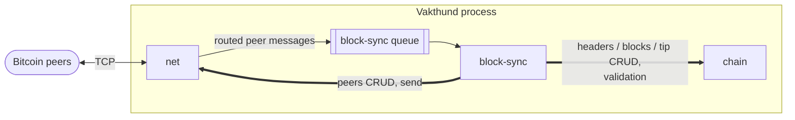

# 1 Introduction

## 1.1 Purpose

This document specifies the requirements of Vakthund v0.1 for its implementers and testers. It defines what Vakthund v0.1 does,
the data it keeps, its interfaces to Bitcoin peers and to its operator, and the constraints its design is bound by.

## 1.2 Scope

Vakthund is a Bitcoin full node. Vakthund v0.1 is a single process made of three modules that interact through direct calls and
in-memory queues. Vakthund v0.1:

- connects to configured peers and keeps the connections alive;
- downloads and validates the header chain and the blocks (initial block download);
- follows new blocks after the initial download (standard mode);
- switches to a competing chain when required (reorg).

The functions excluded from v0.1 are listed in [1.3.3 Limitations](#133-limitations).

## 1.3 Product overview

### 1.3.1 Product perspective

Vakthund v0.1 runs as one process containing the modules `net`, `chain` and `block-sync`. It communicates with Bitcoin
peers over TCP using the Bitcoin P2P protocol, reads one configuration file, and keeps its data under a data directory.

| Interaction                                                | Kind            | Direction              |
|------------------------------------------------------------|-----------------|------------------------|
| Peer messages owned by `block-sync`                        | in-memory queue | `net` → `block-sync`   |
| Peers CRUD, sending a message to a peer                    | direct call     | `block-sync` → `net`   |
| Header and block validation, CRUD for tip, headers, blocks | direct call     | `block-sync` → `chain` |

External interfaces are specified in [3.1](3-requirements/3.1-external-interfaces.md); the constraints on module
boundaries in [3.6](3-requirements/3.6-design-constraints.md).

### 1.3.2 Product functions

| Module                                               | Role                                                                                                                                       |
|------------------------------------------------------|--------------------------------------------------------------------------------------------------------------------------------------------|
| [net](3-requirements/3.2.1-net.md)                   | Peer connections, ping/pong, routing of peer messages to the module that owns them, peers CRUD.                                            |
| [chain](3-requirements/3.2.2-chain.md)               | Validation of headers and blocks, CRUD for tip, headers and blocks, tip updates, the UTXO set.                                             |
| [block-sync](3-requirements/3.2.3-block-sync.md)     | Initial sync, standard mode and reorgs: decides what to download, from which peer, which chain is active, and when the tip is rolled back. |

### 1.3.3 Limitations

Not in v0.1:

- relaying blocks;
- relaying or accepting transactions; a mempool;
- mining;
- wallet;
- inbound connections;
- peer discovery: peers come only from the configuration;
- P2P transport v2 (BIP324): only transport v1 is used;
- any P2P command not listed in the [routing table](3-requirements/3.2.1-net.md#routing-table).

### 1.3.4 Modes

The node is in exactly one of three modes. The mode is owned by `block-sync`.

| Mode     | Specified in                                                                                   | Other processing                             |
|----------|------------------------------------------------------------------------------------------------|----------------------------------------------|
| IBD      | [3.2.3 Initial block download](3-requirements/3.2.3-block-sync.md#initial-block-download-ibd) | Paused, except maintaining peer connections. |
| Standard | [3.2.3 Standard mode](3-requirements/3.2.3-block-sync.md#standard-mode)                        | —                                            |
| Reorg    | [3.2.3 Reorg](3-requirements/3.2.3-block-sync.md#reorg)                                        | Paused, except maintaining peer connections. |

## 1.4 Definitions

| Term                        | Definition                                                                                                                                                           |
|-----------------------------|----------------------------------------------------------------------------------------------------------------------------------------------------------------------|
| active chain                | The chain of blocks from genesis to the tip block whose UTXO set the node holds.                                                                                     |
| tip, tip block              | The last block of the active chain. In height arithmetic `tip` is the height of the tip block; `tip+k` and `tip-k` are heights relative to it.                       |
| chain work                  | The cumulative proof of work of a header and all its ancestors.                                                                                                      |
| header entry                | A stored header together with its height and chain work.                                                                                                             |
| candidate header chain      | Validated and stored headers that extend the active chain beyond the tip and whose blocks are not yet connected.                                                     |
| last common ancestor (LCA)  | Of a header chain and the active chain: the last header of the header chain that is on the active chain.                                                             |
| sequential block            | A block whose parent is the tip block.                                                                                                                               |
| coin                        | An unspent transaction output: amount, scriptPubKey, height of the block that created it, coinbase flag.                                                             |
| UTXO set                    | All coins of the active chain.                                                                                                                                       |
| undo data                   | Of a block: the coins the block spent, in input order.                                                                                                               |
| median time past (MTP)      | The median of the timestamps of the previous 11 blocks.                                                                                                              |
| store                       | A set of tables written together in all-or-nothing updates; the unit of atomicity.                                                                                   |
| table                       | A key-value map inside a store.                                                                                                                                      |
| batch                       | One atomic write to a store that updates one or more of its tables.                                                                                                  |
| module                      | One of `net`, `chain`, `block-sync`.                                                                                                                                 |
| interface                   | The set of direct calls a module exposes to other modules.                                                                                                           |
| queue                       | A bounded in-memory FIFO owned by a module, filled by other modules.                                                                                                 |
| peer                        | A remote Bitcoin node identified by `ip:port`.                                                                                                                       |
| known peer                  | A peer present in the `peer-list` table.                                                                                                                             |
| configured peer             | A peer listed in the `peers` key of the configuration.                                                                                                               |
| connected peer              | A known peer whose in-memory state is `connected`.                                                                                                                   |
| sync peer                   | The peer selected for header download during IBD.                                                                                                                    |
| message                     | One P2P protocol message: a message header (magic, command, payload length, checksum) and a payload.                                                                 |
| command                     | The 12-byte command field of a message header; names the message type.                                                                                               |
| owner (of a command)        | The module that sends and receives messages of that command.                                                                                                         |
| routed message              | A received message pushed by `net` to the queue of its owner as `{peer, command, payload}`.                                                                          |
| block locator               | A list of block hashes of the active chain, newest first, carried by `getheaders`.                                                                                   |
| mutated block               | A block whose transactions do not match its header: a rejection for the merkle root, duplicate transactions, or the witness commitment.                              |
| consensus failure           | A block that is invalid under consensus rules while its header is valid.                                                                                             |
| first start                 | A start of the node with an empty data directory for the network in use.                                                                                             |
