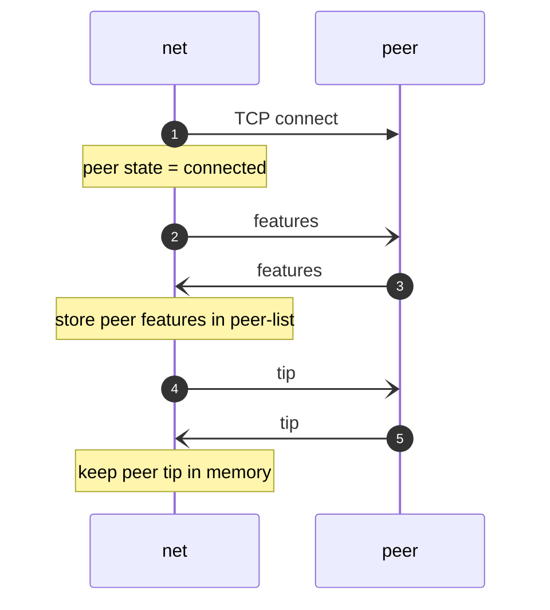
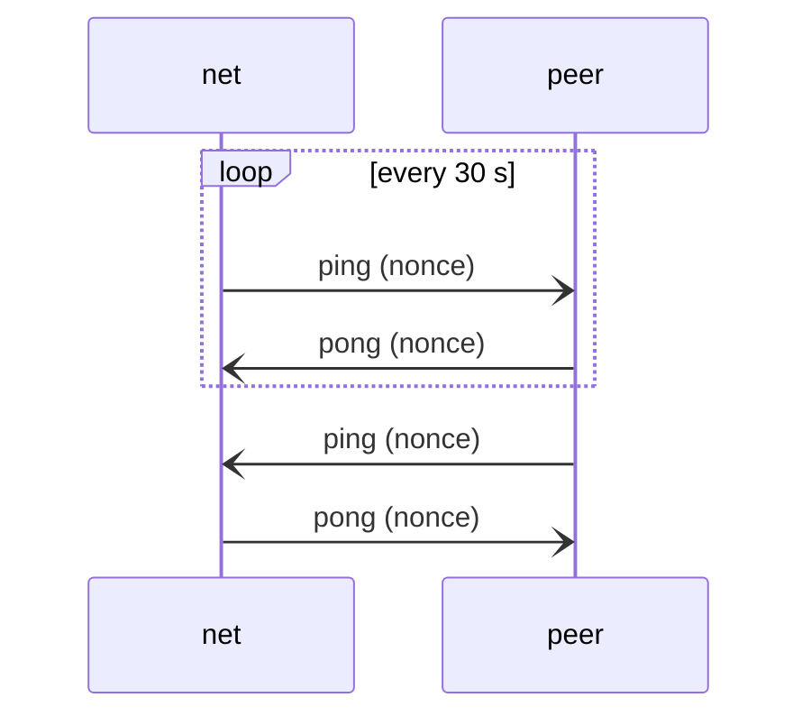
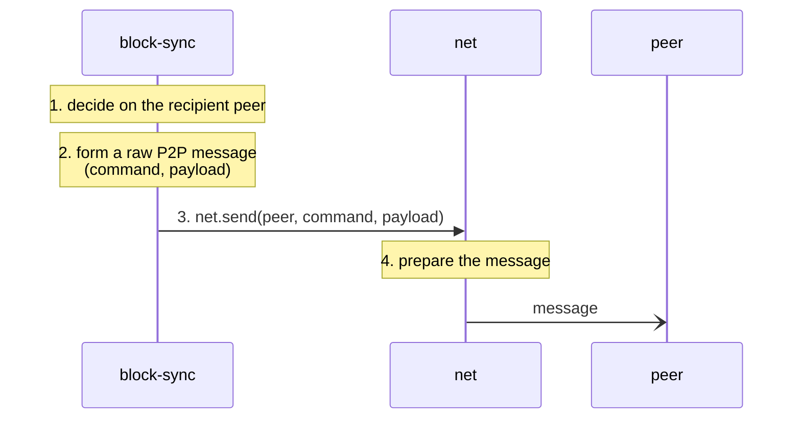
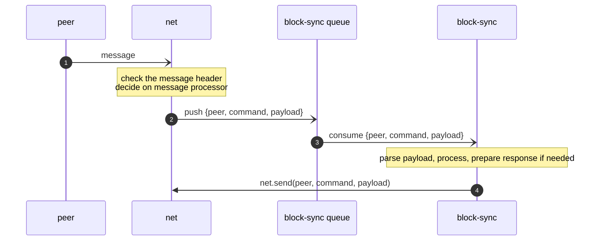

# 3.2.1 Functions: net

`net` handles peers and is the CRUD for peers. It maintains the `peer-list` table: all known peers and the features
recorded for each of them. It knows nothing about messages except `ping`, `pong`, the commands of the connection flow,
and which module owns each command.

## State

| State                                                                        | Where                                                   |
|------------------------------------------------------------------------------|---------------------------------------------------------|
| Known peers: address, features                                               | table `peer-list` ([3.5](3.5-logical-database.md#peer-list)) |
| Per known peer while the process runs: id, connection state, tip, ping times | memory                                                  |

**NET-01** `net` MUST keep every known peer in the `peer-list` table with its address and the features recorded for
it.

**NET-02** `net` MUST keep in memory, for every known peer, the fields of Table 3.2.1-1.

Table 3.2.1-1. In-memory peer fields

| Field                    | Content                                                                 |
|--------------------------|-------------------------------------------------------------------------|
| `id`                     | Peer identifier assigned by `net`, unique while the process runs.       |
| `state`                  | `known` (not connected), `connecting`, `connected`.                     |
| `tip`                    | The peer's tip received during the connection flow.                     |
| `last_ping`, `last_pong` | Times of the last `ping` sent to the peer and the last `pong` received. |

## Peers

**NET-03** Known peers MUST come only from the `peers` configuration key.

**NET-04** `net` MUST treat configured peers as trusted.

**NET-05** `net` MUST maintain a connection to every configured peer. When a configured peer is not connected, `net`
MUST start the connection flow with it. After a disconnection, `net` MUST wait `reconnect_delay_secs` seconds before
starting the connection flow again.

## Connection flow

```
Connect TCP -> peer connected -> Exchange features -> Exchange tips
```

**NET-06** The connection flow with a peer MUST consist of, in order:

1. `net` sets the peer's state to `connecting` and opens a TCP connection to the peer's address;
2. `net` sets the peer's state to `connected`;
3. `net` and the peer exchange features; `net` records the peer's features in `peer-list`;
4. `net` and the peer exchange tips; `net` keeps the peer's tip in memory.

The commands and payloads of the features exchange and of the tip exchange, and the handling of a failed or incomplete
connection flow, are [TBD-02].



## Pings

**NET-07** Every 30 seconds `net` MUST send to each connected peer a `ping` carrying a random 64-bit nonce (BIP31) and
record the time of sending in `last_ping`.

**NET-08** `net` MUST answer every received `ping` with a `pong` carrying the same nonce.

**NET-09** When `net` receives a `pong` whose nonce equals the nonce of the last `ping` sent to that peer, it MUST set
`last_pong` to the time of receipt.

**NET-10** When a connected peer does not answer the last `ping` with a matching `pong` within [TBD-03], `net` MUST
disconnect the peer and reconnect as in NET-05.



## Message exchange

**NET-11** Each command MUST be bound to exactly one owner module, as given in the [routing table](#routing-table). A
message of a command MUST be sent only by its owner and delivered only to its owner.

**NET-12** For a received message, `net` MUST read only the message header: magic, command, payload length, checksum.
It MUST decode the payload only for `ping`, `pong` and the commands of the connection flow. It MUST pass every other
payload to the owner as raw bytes.

**NET-13** `net` MUST check every received message as in EXT-04.

**NET-14** `net` MUST NOT deliver a received message whose command has no owner.

### Sending

**NET-15** On `send(id, command, payload)` for a connected peer, `net` MUST build the message header (magic, command,
payload length, checksum) and send the header followed by the payload, unchanged, to the peer.



### Receiving

**NET-16** `net` MUST push every received message whose owner is `block-sync` to the `block-sync` queue as
`{peer, command, payload}`, where `peer` is the sender's `id`. A received message may be the answer to an earlier
request of the owner; `net` does not distinguish answers from other messages.

**NET-17** When the `block-sync` queue is full, `net` MUST treat it as a node failure (ATT-01).



### Routing table

Table 3.2.1-2. Routing table

| Command                                                        | Owner          |
|----------------------------------------------------------------|----------------|
| `ping`, `pong`                                                 | `net`          |
| commands of the connection flow [TBD-02]                       | `net`          |
| `headers`, `block`, `inv`, `notfound`, `getheaders`, `getdata` | `block-sync`   |
| every other command                                            | none in v0.1   |

## Interface

Direct calls. In v0.1 the only caller is `block-sync`.

**NET-18** `net` MUST expose the calls of Table 3.2.1-3 with the stated behaviour.

Table 3.2.1-3. Interface of `net`

| Call                          | Input                        | Behaviour and output                                                                                                                     |
|-------------------------------|------------------------------|------------------------------------------------------------------------------------------------------------------------------------------|
| `get_peers(state?)`           | optional `state` filter      | Returns the known peers: `peer-list` row with the in-memory fields of Table 3.2.1-1; only peers in the given state when a filter is given. |
| `get_peer(id)`                | peer `id`                    | Returns the known peer with that `id`: `peer-list` row with the in-memory fields, or not found.                                          |
| `add_peer(...)` [TBD-11]      | peer address, features       | Adds the peer to `peer-list`.                                                                                                            |
| `remove_peer(id)`             | peer `id`                    | Removes the peer from `peer-list`.                                                                                                       |
| `connect(id)`                 | peer `id`                    | Starts the connection flow (NET-06) with the peer.                                                                                       |
| `disconnect(id)`              | peer `id`                    | Closes the connection with the peer; its state becomes `known`.                                                                          |
| `send(id, command, payload)`  | peer `id`, command, payload  | Sends the message to the peer as in NET-15. The peer's answer, if any, is delivered through the queue (NET-16), not as a return value.  |

**NET-19** `send` MUST send only when the peer's state is `connected`. The result of `send`, `connect` and
`disconnect` for a peer in another state is [TBD-11].

## Configuration

**NET-20** `net` MUST read the `[net]` table with the keys of Table 3.2.1-4.

Table 3.2.1-4. `[net]` configuration keys

| Key                    | Type              | Content                                      | Default |
|------------------------|-------------------|----------------------------------------------|---------|
| `peers`                | list of `host:port` | peers to connect to                        | `[]`    |
| `reconnect_delay_secs` | integer, seconds  | delay before reconnecting to a disconnected peer | `30` |

```toml
[net]
peers = []                 # peers to connect to: ["host:port", "host:port"]
reconnect_delay_secs = 30  # delay before reconnecting to a disconnected peer
```
