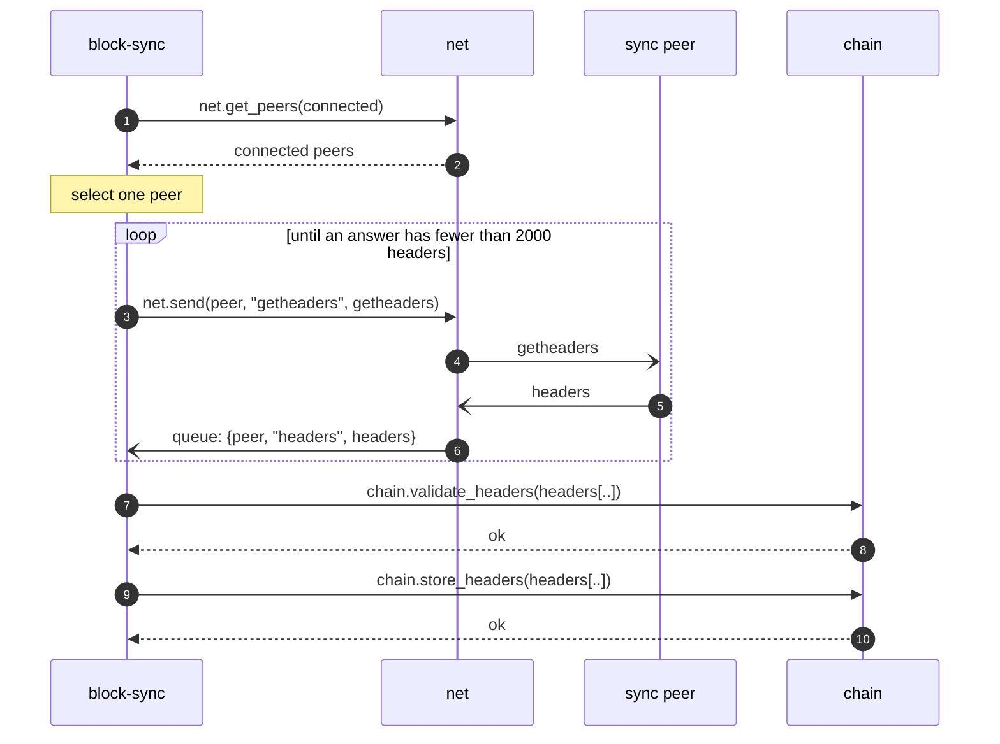
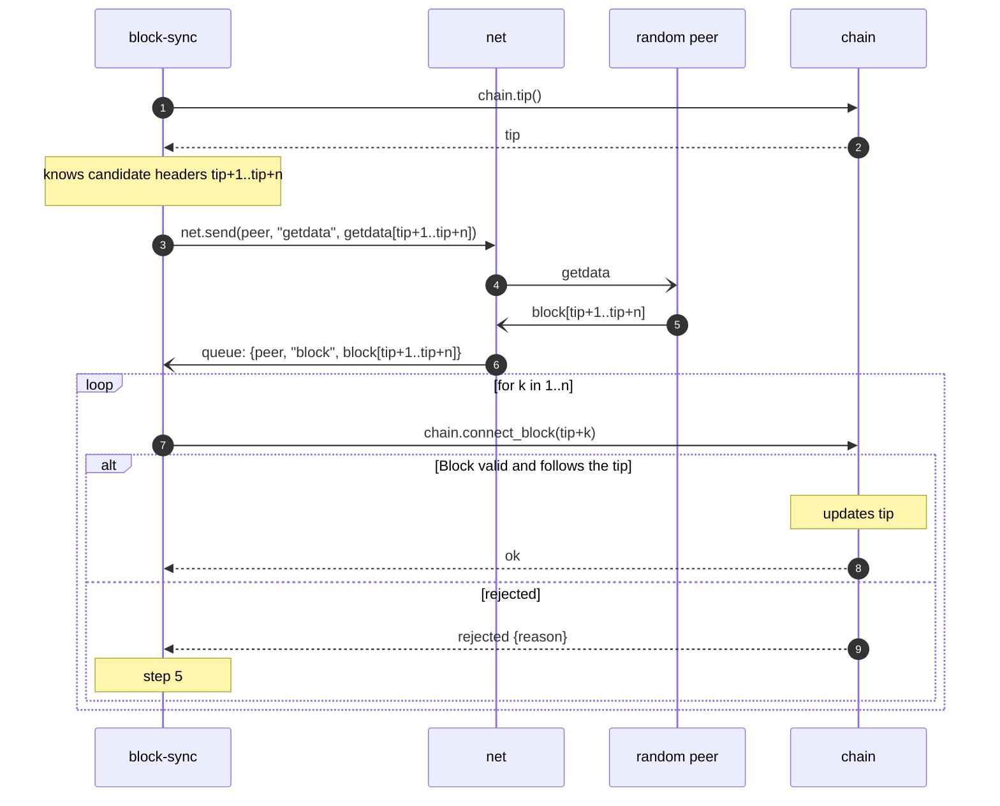
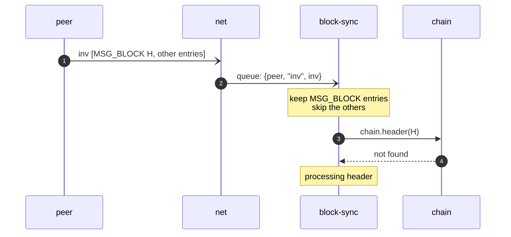
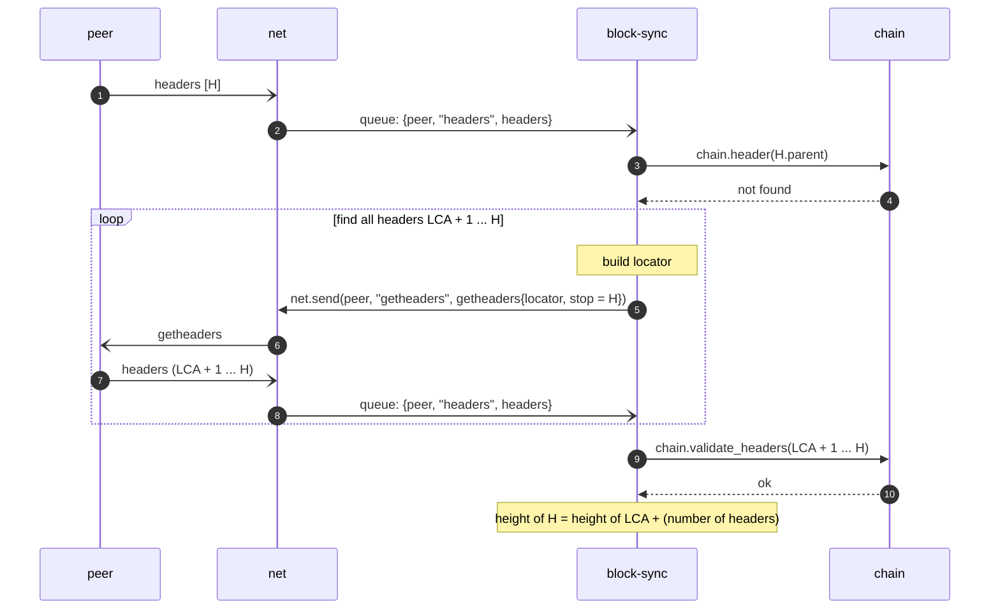
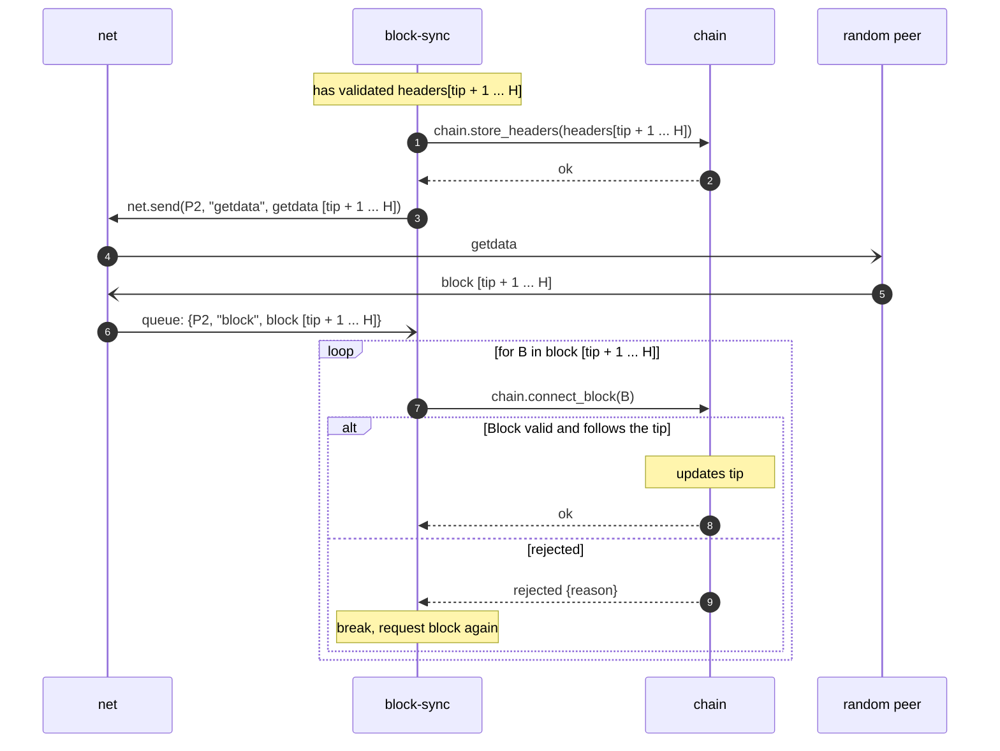
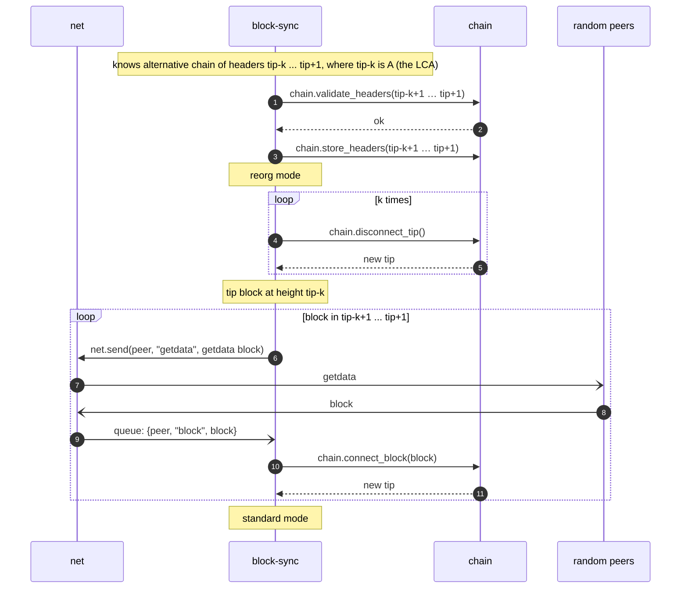

# 3.2.3 Functions: block-sync

`block-sync` is the initiator and processing centre of the node:

- requests new headers and blocks;
- receives new headers and blocks;
- uses [chain](3.2.2-chain.md) as the CRUD for headers and blocks;
- decides which blocks to download;
- decides which chain is active;
- decides whether the tip must be rolled back.

It selects peers using [net](3.2.1-net.md) as the CRUD for peers.

## State

**BSY-01** `block-sync` MUST keep its state only in memory: the mode, candidate headers, requests in flight, and
received blocks not yet connected. `block-sync` has no store.

## Communication

**BSY-02** `block-sync` MUST take its input from its queue, filled by `net` (NET-16), and from its own timers
[TBD-10].

**BSY-03** `block-sync` MUST call other modules only through the calls of Table 3.2.3-1.

Table 3.2.3-1. Calls made by `block-sync`

| Module  | Calls                                                                                                |
|---------|------------------------------------------------------------------------------------------------------|
| `net`   | `get_peers`, `get_peer`, `send`, `disconnect`                                                        |
| `chain` | `validate_headers`, `store_headers`, `header`, `header_at`, `tip`, `connect_block`, `disconnect_tip` |

**BSY-04** `block-sync` MUST expose no calls to other modules. Its only input from other modules is its queue.

**BSY-05** `block-sync` MUST send only the messages of Table 3.2.3-2. Every inventory item of a `getdata` MUST be of
type `MSG_WITNESS_BLOCK` (BIP144).

Table 3.2.3-2. Messages sent by `block-sync`

| Command      | Content                                              | Used in                                                            |
|--------------|------------------------------------------------------|--------------------------------------------------------------------|
| `getheaders` | protocol version, block locator, stop hash           | header download, last common ancestor search, inventory processing |
| `getdata`    | inventory items of type `MSG_WITNESS_BLOCK` (BIP144) | block download                                                     |

**BSY-06** `block-sync` MUST call `store_headers` only with headers for which `validate_headers` returned `ok`, in the
same order.

**BSY-07** P2P messages carry no request identifier. `block-sync` MUST recognise a `headers` message as the answer to
a `getheaders` it sent by the sending peer and by the content: the parent of the first header is a block of the
locator. `block-sync` MUST recognise a `block` message as the answer to a `getdata` it sent by the sending peer and
the block hash.

## Modes

**BSY-08** The node MUST be in exactly one of the modes IBD, Standard, Reorg. `block-sync` MUST own the mode.

**BSY-09** During IBD and during a reorg, `block-sync` MUST process only the messages that are part of the running IBD
or reorg. A message is part of it when it answers a request `block-sync` sent for it (BSY-07). Every other message in
the queue MUST be consumed and discarded.

**BSY-10** During IBD and during a reorg, `block-sync` MUST NOT perform standard-mode processing. `net` continues to
maintain peer connections (NET-05, NET-07 to NET-10).

**BSY-11** `block-sync` MUST enter IBD on first launch, when the stores are empty and the tip is the genesis block.
How `block-sync` is launched and how it switches from IBD to Standard mode is [TBD-04].

## Peer selection

**BSY-12** `block-sync` MUST select peers for its requests as in Table 3.2.3-3, from the connected peers returned by
`net.get_peers`.

Table 3.2.3-3. Peer selection

| Request                     | Peers eligible                                                                                                                  |
|-----------------------------|---------------------------------------------------------------------------------------------------------------------------------|
| Header download (IBD)       | one random connected peer                                                                                                       |
| Block download              | random connected peers whose features include `NODE_NETWORK` and `NODE_WITNESS`, and whose tip is at least the requested height |
| Last common ancestor search | the peer that sent the header                                                                                                   |

## Block locator

**BSY-13** A `getheaders` sent by `block-sync` MUST carry the fields of Table 3.2.3-4.

Table 3.2.3-4. `getheaders` fields

| Field                | Content                                                                                               |
|----------------------|-------------------------------------------------------------------------------------------------------|
| version              | The node's protocol version.                                                                          |
| hash count           | Number of locator hashes, at most 101 (Bitcoin Core `MAX_LOCATOR_SZ`).                                |
| block locator hashes | Hashes of the node's active chain, newest first (the block locator).                                  |
| hash_stop            | Hash of the last header wanted; all zeros for as many headers as the peer allows.                     |

**BSY-14** A full block locator MUST be built from the active chain as Bitcoin Core's `GetLocator`: the tip, the 10
blocks before it, then steps that double at every entry, always ending with genesis. For a tip at height 1000 the
heights are:

```
1000, 999, ..., 990, 988, 984, 976, 960, 928, 864, 736, 480, 0
```

**BSY-15** Headers in a `headers` answer that are already stored MUST be skipped: because the locator is sparse further
back, the block the peer matched can be below the fork point, and the headers between them are already on the active
chain.

How a peer answers `getheaders` is described in [3.8](3.8-supporting-information.md#how-a-peer-answers-getheaders).

## Initial block download (IBD)

### Downloading headers

**BSY-16** `block-sync` MUST download headers during IBD as follows:

1. `block-sync` selects one connected peer (BSY-12), the sync peer.
2. `block-sync` sends `getheaders` to the sync peer, receiving headers in batches of up to 2000. The first request
   carries a full locator of the active chain (BSY-14); each next request carries a locator consisting of the last
   header received.
3. `block-sync` continues until the sync peer has no more headers: an answer with fewer than 2000 headers.
4. `block-sync` validates the whole header chain with `chain.validate_headers` and stores it with
   `chain.store_headers`.

The handling of a `rejected` result of `validate_headers` is [TBD-12].



After step 4 the node has the header history known to the sync peer, validated on the header level only. The stored
headers beyond the tip form the candidate header chain.

### Downloading blocks

In this section `tip` is the height of the tip block at the start of each iteration.

**BSY-17** `block-sync` MUST download blocks during IBD from the beginning of the candidate header chain, in height
order, as follows:

1. All headers, and all blocks up to and including the tip block, are validated and stored.
2. `block-sync` sends `getdata` (`MSG_WITNESS_BLOCK`) for the candidate headers `tip+1 ...` to an eligible peer
   (BSY-12). The number of blocks per request is [TBD-05].
3. When the block `tip+1` is received, `block-sync` calls `chain.connect_block` with it.
4. If the block is valid and sequential, `chain` moves the tip to it. Otherwise `connect_block` returns
   `rejected {reason}`.
5. If the block is rejected:
    - if the reason shows a mutated block, `block-sync` requests the block from another eligible peer and continues
      from step 1;
    - otherwise the block is a consensus failure: `block-sync` MUST report it and the node stops (ATT-02).



## Standard mode

In standard mode the node receives block announcements from connected peers. Peers announce new blocks with `headers`
or with `inv`. For every announced header `block-sync` decides whether it follows the tip or whether the chain has to be
reorganised.

### Processing inventory

**BSY-18** On a received `inv`, `block-sync` MUST keep the entries of type `MSG_BLOCK` and skip every other entry. For
each kept block hash `block-sync` MUST call `chain.header` and skip the hashes whose header is stored. Each remaining
hash is processed as a new header ([Processing headers](#processing-headers)).

**BSY-19** `block-sync` MUST NOT answer an `inv` with `getdata`: blocks are requested only for stored headers.



### Processing headers

A header carries no height. Its height is the parent's height plus one, so it is known only when the parent is stored
in `chain`. For a header with an unknown parent `block-sync` searches the last common ancestor (LCA) of the header's
chain and the active chain, to learn the header's height and whether a reorg is needed.

In this section `H` is a new header, received in a `headers` message or announced by hash in an `inv`, whose header
entry is not stored; `tip` is the height of the tip block.

**BSY-20** For a new header `H`, `block-sync` MUST determine the LCA and the height of `H`:

- if `chain.header(H.parent)` is stored, the height of `H` is the parent's height plus one and the LCA is the nearest
  ancestor of `H` that is on the active chain, found from stored header entries;
- otherwise `block-sync` MUST search the LCA with the peer that announced `H` (BSY-12): it sends `getheaders` with a
  full locator of the active chain (BSY-14) and `hash_stop = H`, and repeats with a locator consisting of the last
  header received until the answer ends with `H`. The result is the header chain `LCA+1 ... H`; headers already
  stored are skipped (BSY-15).

**BSY-21** `block-sync` MUST validate the header chain `LCA+1 ... H` with `chain.validate_headers`. The handling of a
`rejected` result is [TBD-12].

**BSY-22** After validation `block-sync` MUST proceed as follows:

- if the LCA is the tip block: [Appending new headers](#appending-new-headers);
- if the LCA is not the tip block and the height of `H` is greater than `tip`: [Reorg](#reorg);
- if the height of `H` is at most `tip`: the headers `LCA+1 ... H` MUST NOT be stored.



### Appending new headers

In this section the LCA is the tip block and `tip` is its height.

**BSY-23** When the LCA is the tip block, `block-sync` MUST:

1. store the headers `tip+1 ... H` with `chain.store_headers`;
2. send `getdata` (`MSG_WITNESS_BLOCK`) for the blocks `tip+1 ... H` to an eligible peer (BSY-12);
3. call `chain.connect_block` for each received block in height order;
4. handle a rejected block as in BSY-17 step 5.



## Reorg

In this section `A ... B` is a header chain where `A` is on the active chain and no header of `A+1 ... B` is on the
active chain; `tip` is the height of the tip block when the reorg starts, and `k = tip - height(A)`, so that `A` is at
height `tip-k`.

**BSY-24** `block-sync` MUST enter reorg mode when, in standard mode, it holds a header chain `A ... B` validated by
`chain.validate_headers`, with `A` on the active chain, no header of `A+1 ... B` on the active chain, and the height of
`B` greater than `tip`. The chain `A ... B` is usually found by the LCA search of BSY-20, with `A` the LCA.

**BSY-25** A header chain `A ... B` with the height of `B` at most `tip` is not a reorg: the headers `A+1 ... B` MUST
NOT be stored (BSY-22).

**BSY-26** A reorg MUST proceed as follows:

1. `block-sync` stores the headers `A+1 ... B` with `chain.store_headers`.
2. `block-sync` enters reorg mode.
3. `block-sync` calls `chain.disconnect_tip` `k` times. The tip block is then `A`, at height `tip-k`.
4. For each block of `A+1 ... B` in height order: `block-sync` sends `getdata` (`MSG_WITNESS_BLOCK`) for it to an
   eligible peer (BSY-12), receives it, and calls `chain.connect_block` with it.
5. `block-sync` enters standard mode.

**BSY-27** A rejected block of the chain `A+1 ... B` MUST be handled as in BSY-17 step 5.

**BSY-28** If the node stops during a reorg, it MUST relaunch in standard mode. The tip is then at some block between
`A` and `B`, and new blocks are appended over it in standard mode.



## Configuration

**BSY-29** `block-sync` MUST read the `[block-sync]` table. Its keys are [TBD-06].

```toml
[block-sync]

```
