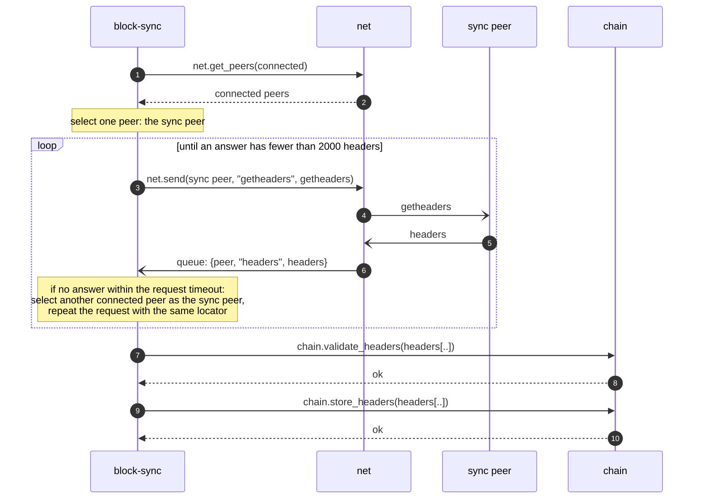
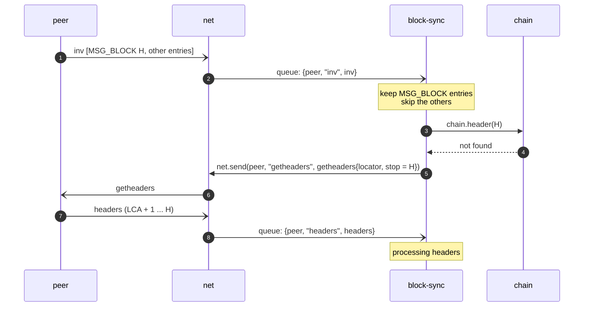
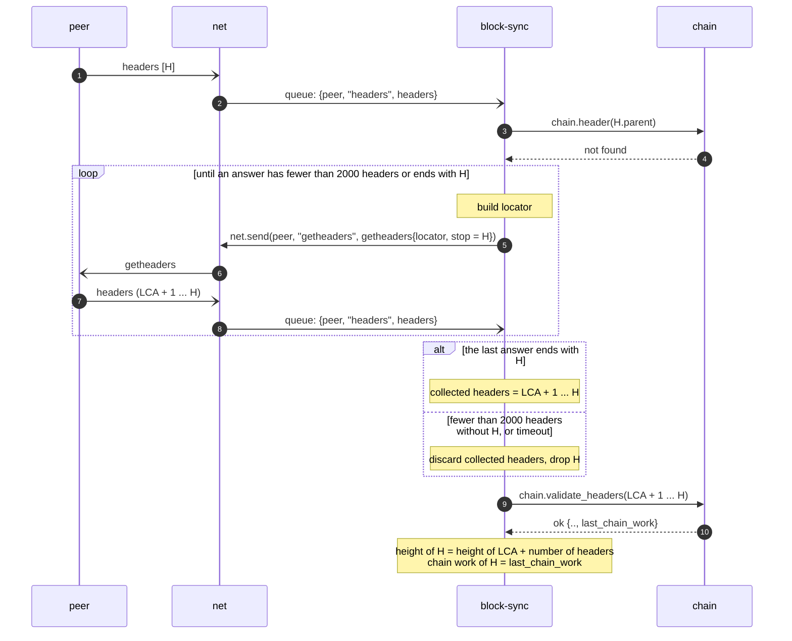

# 3.2.3 Functions: block-sync

`block-sync` is the initiator and processing centre of the node:

- requests new headers and blocks;
- receives new headers and blocks;
- uses [chain](3.2.2-chain.md) as the CRUD for headers and blocks;
- decides which blocks to download;
- decides which chain is active;
- decides whether the tip must be rolled back.

It selects peers using [net](3.2.1-net.md) as the CRUD for peers.

## State

**BSY-01** `block-sync` MUST keep its state only in memory: the mode, candidate headers, requests in flight, and
received blocks not yet connected. `block-sync` has no store.

## Communication

**BSY-02** `block-sync` MUST take its input from its queue, filled by `net` (NET-16), and from its own timers for
request timeouts (BSY-30).

**BSY-03** `block-sync` MUST call other modules only through the calls of Table 3.2.3-1.

Table 3.2.3-1. Calls made by `block-sync`

| Module  | Calls                                                                                                               |
|---------|---------------------------------------------------------------------------------------------------------------------|
| `net`   | `get_peers`, `get_peer`, `send`, `disconnect`                                                                       |
| `chain` | `validate_headers`, `store_headers`, `header`, `header_at`, `tip`, `store_block`, `connect_block`, `disconnect_tip` |

**BSY-04** `block-sync` MUST expose no calls to other modules. Its only input from other modules is its queue.

**BSY-05** `block-sync` MUST send only the messages of Table 3.2.3-2. Every inventory item of a `getdata` MUST be of
type `MSG_WITNESS_BLOCK` (BIP144).

Table 3.2.3-2. Messages sent by `block-sync`

| Command      | Content                                              | Used in                                                            |
|--------------|------------------------------------------------------|--------------------------------------------------------------------|
| `getheaders` | protocol version, block locator, stop hash           | header download, last common ancestor search, inventory processing |
| `getdata`    | inventory items of type `MSG_WITNESS_BLOCK` (BIP144) | block download                                                     |

**BSY-06** `block-sync` MUST call `store_headers` only with headers for which `validate_headers` returned `ok`, in the
same order.

### Requests

**BSY-30** Every `getheaders` and every `getdata` that `block-sync` sends is a request with a deadline of
`request_timeout_secs` seconds after sending. A request that reaches its deadline unanswered has failed. What a failed
request means is stated by each flow: header download in BSY-16, block download in BSY-12 and BSY-32, the last common
ancestor search in BSY-20.

**BSY-07** P2P messages carry no request identifier. A request is answered when a message that matches it by peer and
content arrives:

- for `getheaders`: a `headers` message from the peer whose first header's parent is a block of the request's locator,
  or an empty `headers` message from that peer;
- for `getdata`: a `block` message from the peer carrying a requested hash, or a `notfound` from the peer naming it.

## Modes

**BSY-08** The node MUST be in exactly one of the modes IBD, Standard, Reorg. `block-sync` MUST own the mode.

**BSY-09** During IBD, `block-sync` MUST process only the messages that answer a request it sent for the IBD
(BSY-07); every other message in the queue MUST be consumed and discarded. During reorg mode `block-sync` sends no
requests; every message in the queue MUST be consumed and discarded.

**BSY-10** During IBD and during reorg mode, `block-sync` MUST NOT perform standard-mode processing. `net` continues to
maintain peer connections (NET-05, NET-07 to NET-10).

**BSY-11** `block-sync` MUST enter IBD on first launch, when the stores are empty and the tip is the genesis block.
How `block-sync` is launched and how it switches from IBD to Standard mode other than by BSY-32 is [TBD-04].

## Peer selection

**BSY-12** `block-sync` MUST select peers for its requests as in Table 3.2.3-3, from the connected peers returned by
`net.get_peers`.

Table 3.2.3-3. Peer selection

| Request                     | Peers eligible                                                                                                                                                                                                                                                                                                                                                                                                 |
|-----------------------------|----------------------------------------------------------------------------------------------------------------------------------------------------------------------------------------------------------------------------------------------------------------------------------------------------------------------------------------------------------------------------------------------------------------|
| Header download (IBD)       | one random connected peer: the sync peer                                                                                                                                                                                                                                                                                                                                                                       |
| Block download              | first the peer the blocks were learned from: the sync peer in IBD, the peer that announced the header in standard mode and in a reorg. If that peer does not answer within the request timeout or answers `notfound`: random connected peers whose features include `NODE_NETWORK` and `NODE_WITNESS`, one after another, until a peer returns the block. When every eligible peer has failed for the block: BSY-32. |
| Last common ancestor search | the peer that announced the header, by `headers` or by `inv`                                                                                                                                                                                                                                                                                                                                                   |

## Block download

**BSY-31** Every block the node downloads MUST go through the following steps, in IBD, standard mode and reorg alike:

1. Before requesting a block, `block-sync` calls `chain.header(hash)`. If `has_block` is set, the block MUST NOT be
   requested: it is already stored.
2. `block-sync` sends `getdata` (`MSG_WITNESS_BLOCK`) for the block to an eligible peer (BSY-12).
3. On receipt, `block-sync` calls `chain.store_block(block)`. If the block is rejected:
    - `rejected {mutated}`: `block-sync` requests the block from another eligible peer (BSY-12);
    - `rejected {consensus}`: `block-sync` reports a consensus failure and the node stops (ATT-02).
4. In height order, once the block `tip+1` is stored, `block-sync` calls `chain.connect_block(hash)`. On `rejected`,
   `block-sync` reports a consensus failure and the node stops (ATT-02).

Blocks MAY be received and stored in any order; they MUST be connected in height order.

### Unavailable block

**BSY-32** A block is unavailable when every eligible peer has failed for it: request timeout or `notfound`.
`block-sync` MUST then:

- drop the request for it and the requests that depend on it: the blocks after it in the same download;
- keep everything stored so far: the headers beyond the tip and the blocks already stored with `chain.store_block`;
- continue in standard mode on the current tip. In IBD this is the switch to standard mode. In a reorg the reorg is
  abandoned; nothing has been disconnected.

The blocks are requested again when a later announcement leads to them (BSY-23); the blocks already stored are not
downloaded again (BSY-31 step 1).

## Block locator

**BSY-13** A `getheaders` sent by `block-sync` MUST carry the fields of Table 3.2.3-4.

Table 3.2.3-4. `getheaders` fields

| Field                | Content                                                                                               |
|----------------------|-------------------------------------------------------------------------------------------------------|
| version              | The node's protocol version.                                                                          |
| hash count           | Number of locator hashes, at most 101 (Bitcoin Core `MAX_LOCATOR_SZ`).                                |
| block locator hashes | Hashes of the node's active chain, newest first (the block locator).                                  |
| hash_stop            | Hash of the last header wanted; all zeros for as many headers as the peer allows.                     |

**BSY-14** A full block locator MUST be built from the active chain as Bitcoin Core's `GetLocator`: the tip, the 10
blocks before it, then steps that double at every entry, always ending with genesis. For a tip at height 1000 the
heights are:

```
1000, 999, ..., 990, 988, 984, 976, 960, 928, 864, 736, 480, 0
```

**BSY-15** Headers in a `headers` answer that are already stored MUST be skipped: because the locator is sparse further
back, the block the peer matched can be below the fork point, and the headers between them are already on the active
chain.

How a peer answers `getheaders` is described in [3.8](3.8-supporting-information.md#how-a-peer-answers-getheaders).

## Initial block download (IBD)

### Downloading headers

**BSY-16** `block-sync` MUST download headers during IBD as follows:

1. `block-sync` selects one connected peer (BSY-12): the sync peer.
2. `block-sync` sends `getheaders` to the sync peer, receiving headers in batches of up to 2000. The first request
   carries a full locator of the active chain (BSY-14); each next request carries a locator consisting of the last
   header received.
3. `block-sync` continues until the sync peer has no more headers: an answer with fewer than 2000 headers.
4. `block-sync` validates the whole header chain with `chain.validate_headers` and stores it with
   `chain.store_headers`.

If a `getheaders` to the sync peer fails (BSY-30), `block-sync` MUST select another random connected peer as the sync
peer and repeat the request with the same locator; the download resumes from the last header received. When every
connected peer has failed in turn, `block-sync` MUST wait `request_timeout_secs` seconds and start again with the
first.

The handling of a `rejected` result of `validate_headers` is [TBD-12].



After step 4 the node has the header history known to the sync peer, validated on the header level only. The stored
headers beyond the tip form the candidate header chain.

### Downloading blocks

In this section `tip` is the height of the tip block at the start of each iteration.

**BSY-17** `block-sync` MUST download blocks during IBD from the beginning of the candidate header chain, in height
order, as follows:

1. All headers, and all blocks up to and including the tip block, are validated and stored.
2. `block-sync` knows the candidate headers `tip+1 ...`. It downloads their blocks as in BSY-31: blocks already
   stored are not requested; the others are requested from the sync peer first, then from random eligible peers
   (BSY-12). The number of blocks per `getdata` is [TBD-05].
3. Each received block is stored with `chain.store_block` (BSY-31 step 3).
4. Once the block `tip+1` is stored, `block-sync` calls `chain.connect_block` with its hash (BSY-31 step 4). If the
   block is valid, `chain` moves the tip to it and `block-sync` continues from step 1.
5. If a block is unavailable from every eligible peer, `block-sync` switches to standard mode on the current tip
   (BSY-32).

```mermaid
sequenceDiagram
    autonumber
    participant BS as block-sync
    participant N as net
    participant P as sync peer, then random peers
    participant C as chain
    BS ->> C: chain.tip()
    C -->> BS: tip
    Note over BS: knows candidate headers tip+1..tip+n<br/>skips the blocks with has_block
    BS ->> N: net.send(sync peer, "getdata", getdata[tip+1..tip+n])
    N -) P: getdata
    P -) N: block[tip+1..tip+n]
    N -) BS: queue: {peer, "block", block[tip+1..tip+n]}
    Note over BS: if no answer within the request timeout, or notfound:<br/>request the missing blocks from a random eligible peer;<br/>unavailable from every peer: standard mode
    loop for each received block
        BS ->> C: chain.store_block(block)
        alt stored
            C -->> BS: stored
        else mutated
            C -->> BS: rejected {mutated, reason}
            Note over BS: request the block from another eligible peer
        else invalid
            C -->> BS: rejected {consensus, reason}
            Note over BS: consensus failure, the node stops
        end
    end
    loop for k in 1..n, in height order
        BS ->> C: chain.connect_block(hash of tip+k)
        alt Block valid and follows the tip
            Note over C: updates tip
            C -->> BS: new tip
        else rejected
            C -->> BS: rejected {reason}
            Note over BS: consensus failure, the node stops
        end
    end
```

## Standard mode

In standard mode the node receives block announcements from connected peers. Because `net` sends `sendheaders` in the
connection flow (NET-06), a peer normally announces a new block with a `headers` message carrying the block's header. A
peer falls back to an `inv` carrying only the block hash when it has more than 8 blocks to announce or does not yet know
which blocks the node has. For every announced header `block-sync` decides whether it follows the tip or whether the
chain has to be reorganised.

### Processing inventory

**BSY-18** On a received `inv`, `block-sync` MUST keep the entries of type `MSG_BLOCK` and skip every other entry. For
each kept block hash `H`, `block-sync` MUST call `chain.header(H)` and skip the hashes whose header is stored. For each
remaining hash, `block-sync` MUST obtain the header by starting the last common ancestor search of BSY-20 directly with
the announcing peer: a `getheaders` with a full locator of the active chain and `hash_stop = H`. The `headers` answer
carries the header of `H` and of every block between the active chain and `H`; from there the flow continues as for a
header received in a `headers` message.

**BSY-19** `block-sync` MUST NOT answer an `inv` with `getdata`: blocks are requested only for stored headers.



### Processing headers

A header carries no height. Its height is the parent's height plus one, so it is known only when the parent is stored
in `chain`. For a header with an unknown parent `block-sync` searches the last common ancestor (LCA) of the header's
chain and the active chain, to learn the header's height and whether a reorg is needed.

In this section `H` is a new header, received in a `headers` message or announced by hash in an `inv`, whose header
entry is not stored; `tip` is the height of the tip block.

**BSY-20** For a new header `H`, `block-sync` MUST determine the LCA and collect the new headers:

- if `chain.header(H.parent)` is stored, the LCA is the nearest ancestor of `H` that is on the active chain, found from
  stored header entries, and the collected headers are the stored headers after the LCA followed by `H`;
- otherwise, and for a block hash from an `inv` (BSY-18), `block-sync` MUST search the LCA with the announcing peer
  (BSY-12) by a loop of `getheaders` requests. The first request carries a full locator of the active chain (BSY-14),
  each next request a locator consisting of the last header received; every request carries `hash_stop = H`. After each
  `headers` answer:
    - if the answer has 2000 headers and does not end with `H`, the search continues with the next request;
    - if the answer ends with `H`, the search is complete: the collected headers are `LCA+1 ... H`;
    - otherwise (fewer than 2000 headers without `H`, including an empty answer) `H` is no longer on the peer's active
      chain: the collected headers MUST be discarded and `H` dropped.

  An empty `headers` message from a peer with an outstanding `getheaders` is the answer to that request (BSY-07). A
  request that fails (BSY-30) ends the search: the collected headers MUST be discarded and `H` dropped. Headers already
  stored are skipped (BSY-15).

**BSY-21** `block-sync` MUST validate the collected headers with `chain.validate_headers`. The height of `H` is the
height of the LCA plus the number of headers `LCA+1 ... H`; the chain work of `H` is `last_chain_work`. The handling
of a `rejected` result is [TBD-12].

**BSY-22** After validation `block-sync` MUST proceed as follows:

- if the LCA is the tip block: [Appending new headers](#appending-new-headers);
- otherwise, if the chain work of `H` is greater than the chain work of the tip (`chain.tip`, CHN-22): [Reorg](#reorg);
- otherwise (the chain work of `H` is at most the chain work of the tip): the headers `LCA+1 ... H` MUST NOT be stored.



### Appending new headers

In this section the LCA is the tip block and `tip` is its height.

**BSY-23** When the LCA is the tip block, `block-sync` MUST:

1. store the headers `tip+1 ... H` with `chain.store_headers`;
2. download the blocks `tip+1 ... H` as in BSY-31: blocks already stored are not requested; the others are requested
   from the announcing peer first, then from random eligible peers (BSY-12);
3. store each received block with `chain.store_block` and connect the blocks with `chain.connect_block` in height
   order (BSY-31 steps 3 and 4).

A block unavailable from every eligible peer ends the download (BSY-32): the headers stay stored and the blocks are
requested again on the next announcement.

```mermaid
sequenceDiagram
    autonumber
    participant P1 as announcing peer, then random peers
    participant N as net
    participant BS as block-sync
    participant C as chain
    Note over BS: has validated headers[tip + 1 ... H]
    BS ->> C: chain.store_headers(headers[tip + 1 ... H])
    C -->> BS: ok
    loop for each header in tip + 1 ... H
        alt not has_block
            BS ->> N: net.send(announcing peer, "getdata", getdata[hash])
            N -) P1: getdata
            P1 -) N: block
            N -) BS: queue: {announcing peer, "block", block}
            Note over BS: if no answer within the request timeout, or notfound:<br/>request the block from a random eligible peer;<br/>unavailable from every peer: stop, wait for the next announcement
            BS ->> C: chain.store_block(block)
            C -->> BS: stored, or rejected {mutated | consensus, reason}
        end
    end
    loop for B in tip + 1 ... H
        BS ->> C: chain.connect_block(hash of B)
        alt Block valid and follows the tip
            Note over C: updates tip
            C -->> BS: new tip
        else rejected
            C -->> BS: rejected {reason}
            Note over BS: consensus failure, the node stops
        end
    end
```

## Reorg

Reorg mode covers the disconnection of the node's blocks and the connection of the alternative chain's blocks. It
starts only when every block of the alternative chain is stored, so it sends no requests.

In this section `A ... B` is a header chain where `A` is on the active chain and no header of `A+1 ... B` is on the
active chain; `tip` is the height of the tip block when the reorg starts, and `k = tip - height(A)`, so that `A` is at
height `tip-k`.

**BSY-24** `block-sync` MUST start a reorg when, in standard mode, it holds a header chain `A ... B` validated by
`chain.validate_headers`, with `A` on the active chain, no header of `A+1 ... B` on the active chain, and the chain work
of `B` greater than the chain work of the tip (CHN-22). The chain `A ... B` is usually found by the LCA search of
BSY-20, with `A` the LCA.

**BSY-25** A header chain `A ... B` whose `B` has a chain work at most the chain work of the tip is not a reorg: the
headers `A+1 ... B` MUST NOT be stored (BSY-22). On equal chain work the node keeps its current chain.

**BSY-26** A reorg MUST proceed as follows:

1. `block-sync` stores the headers `A+1 ... B` with `chain.store_headers`.
2. `block-sync` downloads the blocks `A+1 ... B` as in BSY-31: blocks already stored are not requested; the others are
   requested from the peer that announced `B` first, then from random eligible peers (BSY-12); each received block is
   stored with `chain.store_block`. During this download the node continues in standard mode. If a block is
   unavailable from every eligible peer, the reorg is abandoned (BSY-32): the headers and the blocks stored so far
   stay, nothing else changes.
3. When every block of `A+1 ... B` is stored, `block-sync` enters reorg mode.
4. `block-sync` calls `chain.disconnect_tip` `k` times. The tip block is then `A`.
5. `block-sync` calls `chain.connect_block` for `A+1 ... B` in height order. A rejected block is a consensus failure:
   `block-sync` reports it and the node stops (ATT-02).
6. `block-sync` enters standard mode.

**BSY-27** A rejected `store_block` or `connect_block` of a block of `A+1 ... B` MUST be handled as in BSY-31.

**BSY-28** If the node stops during reorg mode, it MUST relaunch in standard mode. The tip is then at some block between
`A` and `B`, and every block of `A+1 ... B` is in `blocks`. The next announcement on the alternative chain finds its
parent stored and the LCA equal to the tip; the remaining blocks are connected from the store without being downloaded
(BSY-23, BSY-31 step 1).

```mermaid
sequenceDiagram
    autonumber
    participant N as net
    participant BS as block-sync
    participant C as chain
    participant P as announcing peer, then random peers
    Note over BS: knows alternative chain of headers tip-k ... tip+1, where tip-k is A (the LCA)
    BS ->> C: chain.validate_headers(tip-k+1 ... tip+1)
    C -->> BS: ok
    BS ->> C: chain.store_headers(tip-k+1 ... tip+1)
    C -->> BS: ok
    Note over BS: standard mode: download the blocks of the alternative chain
    loop block in tip-k+1 ... tip+1, skipping the blocks with has_block
        BS ->> N: net.send(peer, "getdata", getdata block)
        N -) P: getdata
        P -) N: block
        N -) BS: queue: {peer, "block", block}
        Note over BS: if no answer within the request timeout, or notfound:<br/>request the block from a random eligible peer;<br/>unavailable from every peer: abandon the reorg
        BS ->> C: chain.store_block(block)
        C -->> BS: stored, or rejected {mutated | consensus, reason}
    end
    Note over BS: every block of the alternative chain is stored: reorg mode
    loop k times
        BS ->> C: chain.disconnect_tip()
        C -->> BS: new tip
    end
    Note over BS: tip block at height tip-k
    loop block in tip-k+1 ... tip+1, in height order
        BS ->> C: chain.connect_block(block hash)
        C -->> BS: new tip, or rejected (consensus failure, the node stops)
    end
    Note over BS: standard mode
```

## Configuration

**BSY-29** `block-sync` MUST read the `[block-sync]` table with the keys of Table 3.2.3-5.

Table 3.2.3-5. `[block-sync]` configuration keys

| Key                    | Type             | Content                                          | Default |
|------------------------|------------------|--------------------------------------------------|---------|
| `request_timeout_secs` | integer, seconds | deadline of a `getheaders` or `getdata` request  | `60`    |

```toml
[block-sync]
request_timeout_secs = 60 # deadline of a getheaders or getdata request
```
