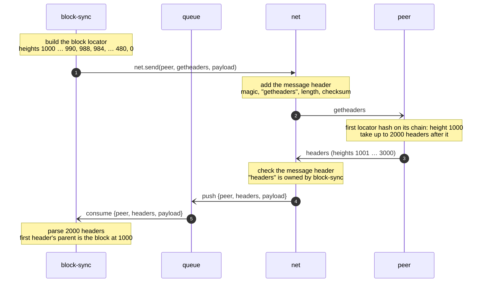

# 3.8 Supporting information

This section is descriptive. It contains no requirements.

## How a peer answers getheaders

A `getheaders` message asks a peer for the headers of its chain that follow some block. The node does not know where the
peer's chain and its own diverge, so the request cannot name one starting block. Instead it carries a block locator: a
list of block hashes from the node's active chain, newest first. The peer matches the list against its own chain to find
a block both chains have, and answers from there.

A peer running Bitcoin Core handles the request as follows:

1. It goes through the locator in order and takes the first hash that is on its own active chain. That block is on both
   chains.
2. It answers with the headers of its active chain that follow that block: at most 2000, ending with the stop hash if
   it reaches it. A zero stop hash means no limit other than 2000.
3. If no locator hash is on its active chain, it answers from the block after genesis.
4. It disconnects a peer whose locator has more than 101 hashes (`MAX_LOCATOR_SZ`).
5. It sends the `version` field but ignores it on receipt.

The parent of the first header in the answer is the block found in step 1, so the node knows that block's height and can
count the heights of all headers in the answer.

A full locator (BSY-14) finds a common block in one round trip, however far back the chains diverge. About 20 hashes
cover any chain length. Because the locator is sparse further back, the block found by the peer can be below the fork
point; the headers between them are already on the node's active chain (BSY-15).

## Example: requesting headers after the tip

`block-sync` asks a peer for the headers that follow its tip at height 1000. The peer's chain extends the node's.

P2P messages carry no request id. `block-sync` recognises the `headers` message as the answer to its `getheaders` by
the peer it comes from and by its content (BSY-07).
